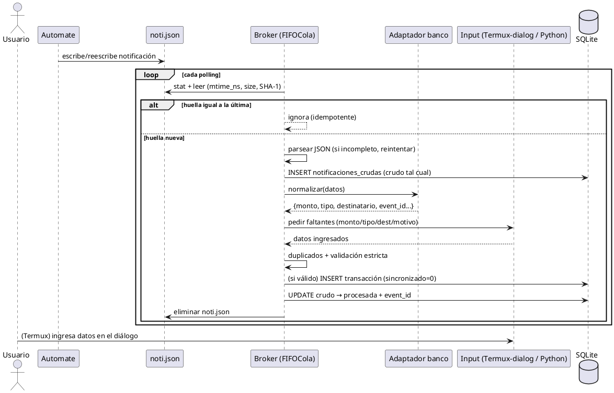

# Flujo End-to-End — Modo Broker (archivo único)

Documento de referencia del flujo completo del modo `automate_broker`.
Complementa `C2-Gestion-Gastos.uml` (flujo de estados) y `C3-Gestion-Gastos.uml`
(componentes).

---

## 1. Idea clave: UN SOLO archivo, reescrito

Automate intercepta la notificación push del banco y **escribe un único archivo
JSON**. En cada notificación **reescribe el mismo archivo** (no crea archivos
nuevos). El broker hace *polling*, detecta el cambio, procesa y espera la
siguiente reescritura. El orden de llegada se respeta → **FIFO de un archivo**.

```
Automate  ──escribe/reescribe──►  noti.json  ◄──polling──  Broker (Python)
     ▲                                                        │
     └────────────── notificación del banco ─────────────────┘
```

### Rutas

| Entorno | Archivo leído | Fuente de la ruta |
|---------|---------------|-------------------|
| **Termux (Android)** | `.../storage/shared/Documents/noti.json` | `config.yaml` → `automate_broker.archivo_notificacion` |
| **Linux** | `./noti_inbox/noti.json` | Fija (desarrollo/pruebas) |

En Linux, si el archivo no existe, se crea el directorio `noti_inbox/` y el
broker queda a la espera.

### Configuración (`config.yaml`)

```yaml
modo_operacion: "automate_broker"

automate_broker:
  activado: true
  archivo_notificacion: "/data/data/com.termux/files/home/storage/shared/Documents/noti.json"
  monitoreo_polling_segundos: 5
```

> Antes se llamaba `directorio_archivos` (incorrecto: era un archivo, no un
> directorio). El código mantiene compatibilidad leyendo también las claves
> antiguas, pero lo correcto es `archivo_notificacion`.

---

## 2. Formato esperado del archivo

Objeto JSON con, al menos, `package`/`packageName` y `message`/`content`:

```json
{
  "package": "pe.com.interbank.mobilebanking",
  "title": "Interbank",
  "message": "Plineaste S/ 20.00 a Juan Perez",
  "timestamp": 1795325030.526
}
```

Campos relevantes:

| Campo | Uso |
|-------|-----|
| `package` / `packageName` | **Enrutamiento** al adaptador del banco |
| `title` / `titulo` | Texto visible / contexto |
| `message` / `content` | Se parsean monto, tipo y destinatario |
| `timestamp` / `when` | Marca de tiempo (epoch o ISO) |

También se acepta un **array** de notificaciones (`[...]`), que se procesa en orden.

---

## 3. Flujo paso a paso (E2E)

1. **Automate** recibe la notificación del banco y la escribe/reescribe en
   `noti.json` (siempre el mismo archivo).
2. **Broker** (cada `monitoreo_polling_segundos`) calcula la **huella** del
   archivo: `(mtime_ns, size, SHA-1(contenido))`.
   - Si es igual a la última procesada (en memoria o en `.broker_state.json`) →
     **no hace nada** (idempotente).
   - Si el JSON está **incompleto** (escritura en curso) → **no marca** y
     reintenta en el siguiente ciclo.
3. **Lectura y parseo** del JSON.
4. **Log crudo (auditoría):** se inserta **todo lo que ingresa**, tal cual, en
   `notificaciones_crudas` (`cuerpo` = JSON completo). `resultado_proceso`
   empieza en `recibida`.
5. **Enrutamiento**: `package`/`packageName` → adaptador según
   `mapeo_adaptadores` + defaults (`ibk`, `yape`, `nfc`, `compartamos`, `manual`,
   `bbva`). Si el paquete no está mapeado → crudo queda `ignorada_paquete_no_mapeado`.
6. **Normalización** por el adaptador: `monto`, `tipo` (gasto/ingreso),
   `destinatario`, `event_id`, `mensaje_raw`, `timestamp_epoch`, etc.
7. **Completar datos faltantes (pregunta al usuario).** Si no se pudo extraer:
   - **Monto** (`monto` ≤ 0/ausente) → pregunta numérica.
   - **Tipo** (no gasto/ingreso) → pregunta `gasto`/`ingreso`.
   - **Destinatario** (`desconocido`/`por definir`/vacío) → pregunta texto.
   - **Motivo** (vacío / “Sin motivo especificado”) → pregunta texto.
   
   Mecanismo (misma interfaz): **Termux → `termux-dialog`**; **Linux → `input()`**.
8. **Reglas de duplicados/consolidación**:
   - Mismo tipo (TRAN+TRAN, PLIN+PLIN, …) **nunca** es duplicado.
   - Tipos diferentes con mismo destinatario+monto en ventana (5 min) → consolidar.
9. **Validación estricta para `transacciones`:** solo se guarda si cumple
   **todas** las reglas: `monto > 0`, `tipo ∈ {gasto, ingreso}`,
   `destinatario` válido y `motivo` válido. Si no → **no** se inserta en
   `transacciones`; el crudo queda como `incompleta`.
10. **GPS**: `termux-location` (Termux) o geolocalización por IP (Linux), con
    fallback a la última ubicación en SQLite. Si no hay, `fuente_gps = none`.
11. **Persistencia** en `transacciones` (`insertar_transaccion`):
    - `id_transaccion` = `event_id` **UNIQUE** → idempotencia.
    - `status = consolidado`, `sincronizado = 0` (pendiente de nube).
    - Al guardar, el crudo se actualiza a `procesada` con su `event_id`.
12. **Eliminación del archivo:** al terminar el procesamiento se **elimina
    `noti.json`** (Automate lo recreará en la siguiente notificación). Si hubo un
    error grave (no se pudo registrar el crudo o falló la BD), el archivo **se
    conserva** para reintento.
13. **Sincronización** (futuro): las filas con `sincronizado = 0` quedan
    disponibles para `--accion sync` o el cliente cloud.

### Tablas involucradas

- `notificaciones_crudas`: **todo** lo que ingresa (log tal cual), siempre.
- `transacciones`: solo registros completos y válidos.
- `abonos_prestamo`: referencias a transacciones de préstamo (cuando se prestó
  o le prestaron dinero) y sus abonos.

### Logs

El broker escribe en consola **y** en archivo (`config.yaml` → `logging.archivo`,
por defecto `./logs/app.log`) con rotación (`logging.rotacion`, p. ej. `10 MB`).

---

## 4. Diagrama de secuencia



---

## 5. Idempotencia y manejo de errores

| Situación | Comportamiento |
|-----------|----------------|
| Archivo sin cambios | Se ignora (no duplica) |
| JSON parcial/incompleto | Warning + reintento (no se marca, no se borra) |
| Archivo ya procesado | Se borra; si reaparece con nuevo contenido, se procesa |
| `event_id` duplicado | `INSERT` rechazado por `UNIQUE` (no duplica) |
| Banco no mapeado | Se registra crudo como ignorado y se borra el archivo |
| Datos faltantes | Se preguntan; si siguen faltando → crudo `incompleta`, sin transacción |
| GPS no disponible | Se guarda con `fuente_gps=none` |
| Error de BD / crudo | Se conserva el archivo para reintento |
| Reinicio del broker | `.broker_state.json` evita reprocesar el último contenido |

Estados persistidos: `.broker_state.json` en la raíz del proyecto
(`{"archivo": "...", "clave": [mtime_ns, size, sha1]}`).

---

## 6. Cómo ejecutarlo

```bash
# Modo broker continuo (usa config.yaml). Ctrl+C para detener.
python3 main.py --broker

# Un solo ciclo (procesa el archivo actual si cambió) y sale
python3 main.py --broker --once

# Sin flags: usa modo_operacion de config.yaml
python3 main.py

# Simular una notificación (Linux)
cat > noti_inbox/noti.json <<'JSON'
{"package":"com.bcp.innovacxion.yapeapp","title":"Yape",
 "message":"Yape! S/ 33.00 a Maria Lopez te envió un pago","timestamp":1795325100.0}
JSON
python3 main.py --broker --once

# Verificar
python3 main.py --accion listar --limit 5
```

---

## 7. Diferencias Termux vs Linux

| Aspecto | Termux | Linux |
|---------|--------|-------|
| Archivo | ruta de `config.yaml` | `./noti_inbox/noti.json` |
| Motivo | `termux-dialog` | entrada por consola (`--accion registro`) o valor por defecto |
| GPS | `termux-location` | geolocalización por IP + fallback SQLite |
| Notificaciones nativas (`--listener`) | disponible | **no disponible** (se rechaza) |

La capa `infraestructura/` selecciona el proveedor correcto automáticamente y
todos retornan el mismo sobre JSON, por lo que el flujo del broker es idéntico.
